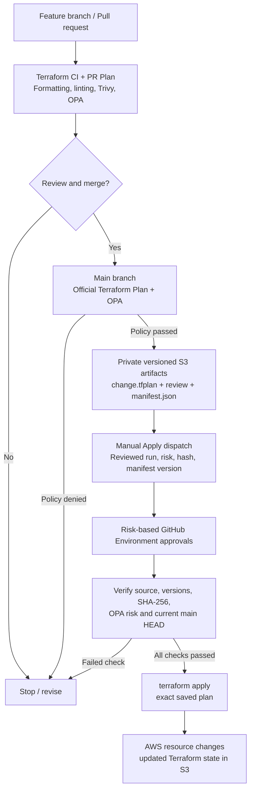

# HongMall Terraform — Risk-Governed AWS Infrastructure as Code

**Terraform · AWS CloudWatch · Open Policy Agent (OPA) · GitHub Actions · OIDC · Amazon S3**

A brownfield Infrastructure as Code (IaC) and Policy-as-Code proof of concept (PoC), informed by an assessment of HongMall's existing AWS CloudWatch monitoring environment. The project demonstrates how to **review infrastructure changes before deployment**, **classify their risk**, **require appropriate approvals**, and **apply a verified Terraform plan** with traceable GitHub Actions evidence.

> [!IMPORTANT]
> **Scope and environment distinction:** The HongMall infrastructure assessment identified **six proposed CloudWatch alarm import candidates**; those production alarms have **not** been imported by this repository. The Terraform deployments and GitHub Actions runs referenced below were performed in a **separate AWS lab environment**. GitHub Environments named `production`, `production-medium`, and `production-high` are approval gates used by the lab pipeline; their names do not imply deployment to HongMall production.

## Contents

- [Project overview](#project-overview)
- [Architecture and workflow](#architecture-and-workflow)
- [Repository structure](#repository-structure)
- [Terraform state and saved plans](#terraform-state-and-saved-plans)
- [CI/CD pipelines](#cicd-pipelines)
- [OPA risk model](#opa-risk-model)
- [Security and deployment guardrails](#security-and-deployment-guardrails)
- [Validation evidence](#validation-evidence)
- [Local verification](#local-verification)
- [Production adoption considerations](#production-adoption-considerations)

## Project overview

### Assessment findings

The original HongMall monitoring assessment covered AWS CloudWatch alarms related to **Amazon EC2**, **Application Load Balancer (ALB)**, and **Amazon DynamoDB**.

| Assessment outcome | Finding |
| --- | --- |
| CloudWatch alarms identified | **22** across the broader assessment |
| Alarms reviewed in detail | **8** |
| Proposed Terraform import candidates | **6** standalone alarms: 2 EC2, 2 ALB, 2 DynamoDB (`log1`) |
| Deferred alarms | **2** DynamoDB (`tmp_syslog`) alarms associated with Application Auto Scaling |

The two Auto Scaling-related alarms were excluded from standalone import consideration to avoid a potential **resource ownership conflict**. The six other alarms remain **proposed candidates**, subject to ownership, configuration, and change-approval checks.

### Engineering objectives

- Demonstrate safe adoption of existing CloudWatch alarms using Terraform **declarative import blocks**.
- Preserve existing monitoring configuration during import-only changes.
- Establish remote Terraform state storage and native S3 state locking.
- Build separate **PR validation**, **Main Plan**, and **controlled Apply** workflows.
- Evaluate proposed changes using **OPA/Rego** before deployment.
- Use short-lived **GitHub Actions OIDC → AWS STS** credentials, not long-lived AWS access keys.
- Validate risk-based approval paths and fail-closed security controls with reproducible lab scenarios.

## Architecture and workflow



**Two different plans serve two different purposes:**

- **PR Plan:** pre-merge feedback for reviewers; **never used as the approved deployment artifact**.
- **Main Plan:** generated from `main`, evaluated by OPA, and preserved in private S3 for a later, manually reviewed Apply.

AWS access from GitHub Actions uses **OIDC federation** and separate plan/apply IAM roles. The credentials are temporary; the workflows do not rely on committed static AWS access keys.

## Repository structure

```text
hongmall-terraform/
├── .github/
│   └── workflows/
│       ├── terraform-ci.yml
│       ├── terraform-plan.yml
│       └── terraform-apply.yml
├── policies/
│   ├── risk_policy.rego
│   ├── resource_classification.json
│   ├── test_delete.json
│   ├── test_iam_unsafe.json
│   ├── test_s3_public.json
│   ├── test_unassessed.json
│   ├── test_unknown.json
│   └── test_update.json
├── backend.tf
├── cloudwatch_alarms.tf
├── import.tf
├── providers.tf
├── versions.tf
├── .terraform.lock.hcl
└── .gitignore
```

### Main files

| Path | Responsibility |
| --- | --- |
| [`.github/workflows/terraform-ci.yml`](.github/workflows/terraform-ci.yml) | PR checks, workflow lint, pre-merge Terraform Plan, and OPA policy evaluation. |
| [`.github/workflows/terraform-plan.yml`](.github/workflows/terraform-plan.yml) | Official Main Plan, OPA gate, and upload of a saved binary plan and versioned metadata to private S3. |
| [`.github/workflows/terraform-apply.yml`](.github/workflows/terraform-apply.yml) | Manual, risk-gated Apply of the exact reviewed plan after integrity and policy rechecks. |
| [`policies/risk_policy.rego`](policies/risk_policy.rego) | Risk classification, severity detection, risk matrix, policy denial, and pass/block decision. |
| [`policies/resource_classification.json`](policies/resource_classification.json) | Resource-address-to-criticality registry (`low`, `medium`, `high`). |
| [`policies/test_*.json`](policies/) | Local simulated Terraform Plan JSON inputs for exercising policy cases. |
| [`backend.tf`](backend.tf) | S3 backend configuration and native `.tflock` locking. |
| [`cloudwatch_alarms.tf`](cloudwatch_alarms.tf) | Terraform CloudWatch alarm resource definitions used in the lab. |
| [`import.tf`](import.tf) | Declarative import mappings for existing lab CloudWatch alarms. |
| [`providers.tf`](providers.tf) | AWS provider configuration (`us-east-1`). |
| [`versions.tf`](versions.tf) | Terraform and AWS provider version constraints. |
| [`.terraform.lock.hcl`](.terraform.lock.hcl) | Selected provider dependency versions and checksums. |
| [`.gitignore`](.gitignore) | Excludes local/generated and potentially sensitive Terraform files. |

The `policies/` directory also includes separate fixtures for threshold updates, deletion, unclassified resources, unassessed changes, unsafe S3 public access settings, and an unsafe IAM trust-policy scenario. These are **policy-test inputs**, not evidence of real AWS changes.

## Terraform state and saved plans

### Remote Terraform state

[`backend.tf`](backend.tf) configures an **Amazon S3 backend** in `us-east-1` with:

- A private state object at `hongmall/cloudwatch/terraform.tfstate`.
- `encrypt = true` to request server-side encryption for the state object.
- `use_lockfile = true` for **native S3 state locking**.

When a supported Terraform operation holds the state lock, the backend creates a temporary `.tflock` object and removes it when the lock is released. **There is no DynamoDB state-lock table in this backend configuration.**

### Reviewed Terraform deployment plans

Saved deployment plans are a **separate concern from Terraform state**. The Main Plan workflow stores the reviewed plan and its metadata in private, versioned S3 objects:

| Artifact | Role |
| --- | --- |
| `change.tfplan` | Binary Terraform plan to be applied later; not posted publicly as plaintext. |
| `plan-review.txt` | Private human-readable review artifact. |
| `manifest.json` | Index/metadata binding repository, commit, workflow run, selected risk, artifact keys, object version IDs, and SHA-256 hashes. |

The Apply workflow retrieves the **specific approved S3 object versions**, verifies the plan checksum and source context, re-evaluates policy, and applies the saved plan rather than generating an unreviewed replacement.

## CI/CD pipelines

### 1. Pull request — [`Terraform CI`](.github/workflows/terraform-ci.yml)

**Trigger:** PR targeting `main` (plus optional manual workflow dispatch for the CI workflow).

1. Run `terraform fmt -check`, `terraform init -backend=false`, and `terraform validate`.
2. Run **TFLint**, **Trivy IaC** checks (high/critical findings fail), and **actionlint** for workflow syntax.
3. For a trusted PR, run a **Terraform PR Plan** and evaluate OPA rules.
4. Surface a concise plan/policy result to support human code review before merge.

**Purpose:** catch quality, security, and infrastructure-change concerns **before merging**. This plan is **not** the production/deployment plan artifact.

### 2. Main branch — [`Terraform Plan`](.github/workflows/terraform-plan.yml)

**Trigger:** push to `main` (including an ordinary PR merge), or manual dispatch on `main`.

1. Initialize the S3 backend and generate the official Main Plan.
2. Produce private review/plan data and evaluate **OPA** against Terraform Plan JSON.
3. Stop if the change is blocked or cannot be assigned an accepted risk level.
4. For a passing plan with changes, upload the binary plan, review artifact, and versioned manifest to private S3.
5. Publish a concise workflow summary with risk classification and identifiers for review.

**Purpose:** create an immutable-by-reference, auditable **deployment candidate** bound to a specific Main commit, run, risk result, and artifact versions.

### 3. Manual deployment — [`Terraform Apply`](.github/workflows/terraform-apply.yml)

**Trigger:** `workflow_dispatch` on `main`. The operator supplies:

- `plan_run_id` — reviewed Main Plan workflow run.
- `approved_plan_sha256` — expected SHA-256 of `change.tfplan`.
- `approved_manifest_version_id` — exact S3 manifest object version.
- `approved_risk_level` — reviewed OPA risk (`low`, `medium`, or `high`).

Approval routing is controlled through GitHub Environments:

| Reviewed risk | Approval path |
| --- | --- |
| **Low** | `production` approval; medium/high gates are skipped. |
| **Medium** | `production-medium` gate, then `production` approval. |
| **High** | `production-high` gate, then `production` approval. |
| **Blocked** | No deployable Main Plan / no Apply approval path. |

The Apply job then validates the original Main Plan run and OPA result, manifest provenance, S3 object versions, SHA-256 integrity, approved versus recomputed OPA risk, and that `main` has not advanced. It applies **only the verified saved `.tfplan`**. A failed or mismatched check stops deployment.

> The risk input selects an approval path; it **does not independently authorize a deployment**. The Apply job cross-checks it against the manifest and a fresh OPA evaluation.

## OPA risk model

The policy in [`risk_policy.rego`](policies/risk_policy.rego) evaluates Terraform changes along two dimensions:

1. **Resource criticality:** assigned in [`resource_classification.json`](policies/resource_classification.json) based on the intended workload/business importance in the lab scenario.
2. **Change severity:** derived from recognized Terraform Plan operations, including import-only changes, CloudWatch threshold updates, and pure deletion.

### Severity rules implemented in this PoC

| Change pattern | Severity |
| --- | --- |
| Import-only (`no-op` plus importing metadata) | **Low** |
| CloudWatch alarm threshold update | **Medium** |
| Pure resource deletion | **High** |
| Other operations without a matching severity rule | **Unassessed → blocked** |

### Risk decision matrix

| Resource criticality ↓ / Change severity → | Low | Medium | High |
| --- | --- | --- | --- |
| **Low** | Low | Low | Medium |
| **Medium** | Low | Medium | High |
| **High** | Low | High | High |

If policy checks pass, the **overall plan risk** is the highest final risk among assessed resource changes. **Unknown resource classifications, unassessed operations, or explicit security denials** cause the policy gate to fail (`policy_pass = false`, `overall_risk = "blocked"`).

### Explicit security controls

- Reject changes that disable selected **S3 Public Access Block** protections.
- Reject an unsafe change to the protected **Terraform Apply IAM role's OIDC trust policy**.
- Enforce an independent **Apply-stage guardrail** against delete/replace operations and certain output changes. A deletion can be classified *High severity* by OPA while still being **ineligible for Apply** in the current pipeline.

The matrix is a **PoC policy design**, not an AWS-managed risk standard or a claim that business criticality is automatically discovered by OPA.

## Security and deployment guardrails

- **GitHub OIDC and AWS STS:** short-lived federated credentials for automation.
- **IAM role separation:** plan and apply use different AWS roles and permission scopes.
- **GitHub Environment protections:** additional medium/high approval gates plus the general `production` gate.
- **Private plan artifacts:** deployment plans remain in private S3 rather than public PR comments.
- **Artifact integrity:** S3 object versions, manifest metadata, and SHA-256 verification.
- **Policy re-evaluation:** Apply checks OPA again against the retrieved plan.
- **Source verification:** checks original Main Plan evidence and rejects a changed Main HEAD.
- **Fail-closed deployment:** denied, unassessed, stale, mismatched, or unsupported operations do not proceed to Apply.

## Validation evidence

The following three deployments are **verified AWS lab runs**, not imports or updates of HongMall production alarms.

| Case | Tested change | OPA result | Evidence |
| --- | --- | --- | --- |
| **01 — Low risk** | Import existing `hongmall-tf-lab-import-demo` alarm; **1 import, 0 create/update/delete**. | Low / Pass | [Main Plan](https://github.com/jeremyrc760/hongmall-terraform/actions/runs/40575459002) · [Apply success](https://github.com/jeremyrc760/hongmall-terraform/actions/runs/40616734840) |
| **02 — Medium risk** | Change simulated service CPU alarm threshold **80 → 85** in place. | Medium / Pass | [Main Plan](https://github.com/jeremyrc760/hongmall-terraform/actions/runs/40624975607) · [Apply success](https://github.com/jeremyrc760/hongmall-terraform/actions/runs/40625634120) |
| **03 — High risk** | Change a **simulated high-criticality** custom alarm threshold **0 → 1** in place. **No deletion was performed.** | High / Pass | [Main Plan](https://github.com/jeremyrc760/hongmall-terraform/actions/runs/40733919828) · [Apply success](https://github.com/jeremyrc760/hongmall-terraform/actions/runs/40734485738) |
| **04 — Policy deny** | Simulated Plan JSON disables an S3 Public Access Block setting; **local OPA test only**. | Blocked / Denied | [`test_s3_public.json`](policies/test_s3_public.json) + [`risk_policy.rego`](policies/risk_policy.rego) |

For Case 03, the resource address and alarm name contain the legacy string `critical_monitor_delete`; the **validated operation was a threshold update**, not an alarm deletion. The criticality classification is part of a controlled lab simulation, not evidence of a live critical-service heartbeat.

The medium-risk threshold change was used to **demonstrate governance for a plausible tuning scenario**, not to establish a measured reduction in false alerts.

## Local verification

**Prerequisites:** Terraform meeting [`versions.tf`](versions.tf) requirements (`>= 1.10.0, < 2.0.0`), the required AWS provider plugin, and OPA with Rego v1 support. The GitHub workflows pin **OPA v1.21.4**.

The commands below check code and policy locally **without deploying infrastructure**:

```bash
terraform fmt -check -recursive
terraform init -backend=false -input=false
terraform validate
opa check --strict policies/risk_policy.rego
```

Evaluate the simulated **S3 public-access denial** fixture:

```bash
opa eval \
  --data policies/risk_policy.rego \
  --data policies/resource_classification.json \
  --input policies/test_s3_public.json \
  --format pretty \
  '{
    "policy_pass": data.terraform.risk.policy_pass,
    "overall_risk": data.terraform.risk.overall_risk,
    "deny": data.terraform.risk.deny
  }'
```

Expected policy decision: `policy_pass = false`, `overall_risk = "blocked"`, with a denial identifying the unsafe S3 public-access setting.

> [!CAUTION]
> Do **not** run `terraform apply` against an account or workspace you are not authorized to change. This repository includes real Terraform resource blocks, and the CI/CD deployment path expects preconfigured IAM roles, private S3 artifacts, and protected GitHub Environments. The commands above are intended for **local inspection only**.

## Production adoption considerations

The independent lab PoC demonstrates a possible **governance pattern**. It is **not a claim of completed HongMall production migration**, cost savings, or measured monitoring reliability improvement.

A proposed next phase would be:

1. **Validate ownership and configuration** for the six candidate CloudWatch alarms, including current alarm actions and dependencies.
2. **Run a controlled import-only pilot** for one approved low-risk alarm; confirm no unintended change to monitoring behavior.
3. **Assess operational suitability** of OPA, IAM permissions, S3 controls, and approval processes before expanding Terraform management.

---

**Project focus:** brownfield infrastructure adoption, Terraform state governance, Policy-as-Code, secure CI/CD, and risk-aware change control.
